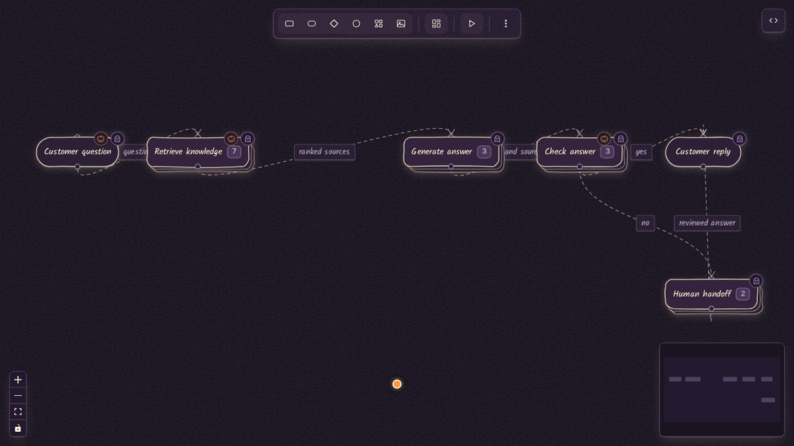
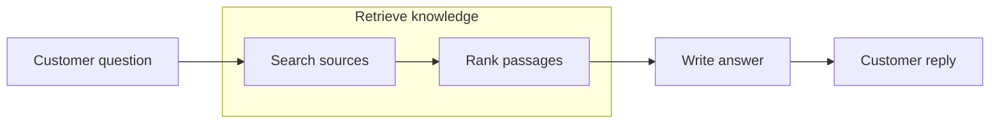

<div align="center">
  
  <h1>marmerlade</h1>
  <p><strong>Foldable diagrams. Linked wiki pages. Markdown slides.</strong></p>
  <p>A visual workspace built around Mermaid, with a live canvas for your AI assistant.</p>
  <p>
    <a href="#quick-start">Quick start</a> ·
    <a href="#try-a-complete-workspace">Example workspace</a> ·
    <a href="docs/mcp.md">MCP setup</a> ·
    <a href="docs/usage.md">User guide</a> ·
    <a href="#contributing">Contribute</a>
  </p>
</div>



<p align="center"><sub>The AI support agent example in Halloween mode. Unfold nested groups, play the flow, and inspect its Mermaid source.</sub></p>

## Start with the overview. Unfold the details.

Marmerlade is a canvas diagramming tool for systems that need more than one level
of detail. Fold a group into a single card, then unfold it to explore the nodes
inside. Connections follow the folded cards, so you can trace the system at any
depth.

Edit visually or write Mermaid. Attach Markdown pages and slide decks to the same
nodes, and embed live diagrams in both. When a diagram changes, its embeds update
across the canvas, wiki, and slides.

| | What you can do |
| --- | --- |
| **Foldable diagrams** | Nest groups to any depth. Fold a whole level at once, or open one group at a time. |
| **Mermaid editing** | Edit source beside the canvas. Import flowcharts and export Mermaid for other tools. |
| **Connected wiki** | Link multiple pages to a node, share pages across nodes, follow wikilinks and backlinks. |
| **Slides as Markdown** | Write decks with live diagram embeds, speaker notes, and a presenter view. Export Markdown or print to PDF. |
| **Flow playback** | Animate connections in sequence, step through a flow, or export a loop as a GIF. |
| **Live MCP canvas** | Let an assistant read and edit a local workspace while the browser follows its changes. |
| **Paper and ink** | Draw with hand-drawn shapes, icons, and images. Choose paper, dark, blueprint, and other app styles. |

## Quick start

Requires **Node.js 22.12 or newer**.

```bash
git clone https://github.com/han002x/merfolk.git marmerlade
cd marmerlade
npm install
npm run dev
```

Open the URL printed in your terminal, normally **http://localhost:5173**.
The browser app autosaves to localStorage. Use **More actions → Export file** to
save a portable `.marmerlade.json` workspace.

### Make your first diagram

Open the **Mermaid** panel with `M` and paste:



Select the **Retrieve knowledge** group and press `F` to fold it. Select a node
and press `W` to open its wiki page, or `K` to open its slide deck. Press `P` to
play the flow.

### Try a complete workspace

The [AI support agent example](examples/ai-support-agent/README.md) follows a
customer question through retrieval, generation, checking, and human handoff.
It includes nested groups, eight linked wiki pages, and a six-slide deck.

1. Download the [example bundle](examples/ai-support-agent-demo.zip) and extract it.
2. In Marmerlade, choose **More actions → Import file**.
3. Select `ai-support-agent.merfolk.json` for the folded overview, or
   `ai-support-agent.expanded.merfolk.json` to see every group open.

Import replaces the current workspace. Export your work first if you want to keep
it. The example's `.merfolk.json` filenames use the same import format as
`.marmerlade.json`.

## Work with an AI assistant

The local MCP server gives your assistant access to diagrams, wiki pages, and
slide decks. The browser shows the same workspace as the assistant edits it.

Build the app from your checkout:

```bash
npm run build
```

Then register `dist/cli.js` with your MCP client using absolute paths.
For clients that use `mcpServers` JSON:

```json
{
  "mcpServers": {
    "marmerlade": {
      "command": "node",
      "args": [
        "/absolute/path/to/marmerlade/dist/cli.js",
        "--file",
        "/absolute/path/architecture.marmerlade.json"
      ]
    }
  }
}
```

Ask your assistant to create a diagram and call `open_workspace` to open the live
canvas. The server saves edits to the JSON file. This workspace is separate from
the browser app's localStorage.

Choose your client for configuration file locations and setup steps:

| Client | Setup |
| --- | --- |
| Kiro | [JSON configuration and automatic reconnect](docs/mcp.md#kiro) |
| Codex | [TOML configuration or CLI registration](docs/mcp.md#codex) |
| Claude Desktop / Cursor | [JSON configuration](docs/mcp.md#other-clients) |

See [MCP setup](docs/mcp.md) for the tool reference and saving and recovery behavior.

## Keep your work portable

| Format | What it contains |
| --- | --- |
| `.marmerlade.json` | The complete workspace, including diagrams, styling, positions, fold state, wiki pages, and slide decks. |
| Mermaid | Diagram structure and page/deck references. Document content stays in the JSON workspace. |
| Slide Markdown | A standalone deck with diagram embeds converted to Mermaid fences. Slidev renders those fences; Marp needs a Mermaid plugin. |
| PDF / GIF | Print a presentation to PDF, or export a flow playback loop as a GIF. |

Mermaid support covers a [flowchart subset](docs/usage.md#mermaid-support),
including subgraphs, classic shapes, labeled edges, and icon metadata.

## Documentation

| Guide | Read it for |
| --- | --- |
| [User guide](docs/usage.md) | Canvas controls, folding, wiki editing, slides, appearance, and keyboard shortcuts. |
| [MCP and live canvas](docs/mcp.md) | Assistant configuration, tools, workspace files, and conflict recovery. |
| [Data model](ONTOLOGY.md) | Entities, relationships, Mermaid mapping, and document syntax. Also available in the app under **Docs**. |
| [Development](docs/development.md) | Build commands, checks, source layout, and packaging. |
| [Design requirements](DESIGN.md) | The project's UI and architecture principles. |

Built with React, TypeScript, React Flow, Zustand, Dagre, and Tiptap.

## Contributing

Bug reports, documentation fixes, and pull requests are welcome. For bugs, include
steps to reproduce and a small Mermaid or JSON example when possible. Discuss
larger changes in an issue before starting implementation.

Run the relevant checks before opening a pull request:

```bash
npm run lint
npm test
npm run test:mcp
npm run build
```

For UI changes, also run the browser tests. See [development](docs/development.md)
for setup and the full check list.
