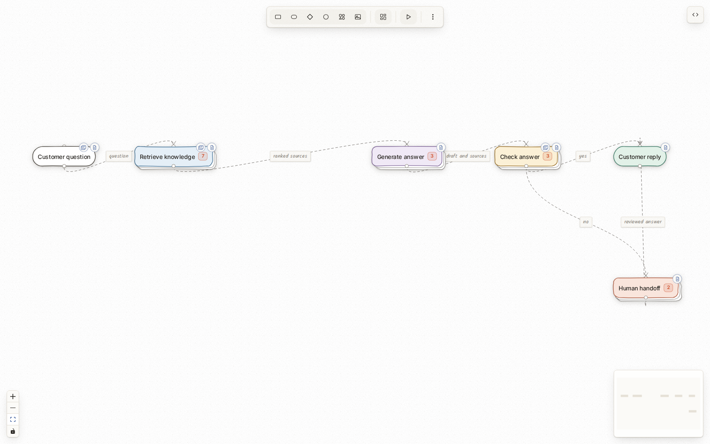

# AI support agent demo

A fictional support system for Harbor Notes. Follow "How do I export my workspace?" through retrieval, generation, checking, and a possible human handoff.



The complete bundle is [ai-support-agent-demo.zip](../ai-support-agent-demo.zip). Extract it, then import one of the JSON files below.

## Import

1. Run Merfolk with `npm run dev` from the repository root.
2. Open the app. Use **More actions → Export file** first if you want to keep the current canvas.
3. Choose **More actions → Import file** and select `ai-support-agent.merfolk.json` from this folder.

The import replaces the current diagram and its documents. It restores a folded overview, colors, layout, eight wiki pages, their shared links, and one six-slide deck. It does not change your app appearance settings.

`ai-support-agent.expanded.merfolk.json` contains the same material with every group unfolded and a top-down layout. Import either file again to reset the demo.

## Files

| File | Use |
| --- | --- |
| `ai-support-agent.merfolk.json` | Start here. Full workspace with groups folded. |
| `ai-support-agent.expanded.merfolk.json` | Full workspace with every group open. |
| `ai-support-agent.mmd` | Paste into the Mermaid tab. Includes structure and page/deck references, but no document bodies, styles, positions, or fold state. |
| `workflow.mmd` | Editable diagram source used by the builder. |
| `wiki/*.md` | Editable source for the eight linked pages. |
| `slides.md` | Editable deck source with live Merfolk diagram embeds. |
| `slides.portable.md` | Standalone deck with the embeds converted to Mermaid fences. |
| `build.ts` | Rebuild the import files from the editable sources. |

Use the JSON file for a complete reimport. Importing Mermaid alone cannot restore page or deck content. Its relative wiki links work when the matching JSON workspace is already loaded. The current app may export JSON with a `.marmerlade.json` filename; that uses the same import format.

The portable deck renders Mermaid fences in Slidev. Marp requires a Mermaid plugin. Its diagram fences are snapshots; the deck inside Merfolk keeps live embeds.

## Walkthrough

Allow about four minutes. The canvas starts with six cards and two routes to Customer reply.

1. **Overview.** Follow Customer question, Retrieve knowledge, Generate answer, Check answer, and Customer reply. Point out the alternate Human handoff route.
2. **Unfold.** Click the count tab on Retrieve knowledge. Hybrid search stays folded inside it. Click that card's count tab to expose the two search paths. Fold it again with its dog-eared corner to see incoming connections merge into a crease. Pan or zoom to inspect the detail. `F` also toggles the selected group.
3. **Explain the flow.** Press `P` to play or pause. Use `.` and `,` to step. Both decision branches animate because playback explains the graph rather than evaluating a request.
4. **Open the wiki.** Select Retrieve knowledge and press `W`. Its first page is Retrieval design. Switch to Retrieval runbook with the page picker. Follow the links to Hybrid search and Response contract. Response contract is also linked to Generate answer, Check answer, and Customer reply.
5. **Present.** Select Customer question and press `K`. Open the deck in its own window with the expand button. Present it, then use the arrow keys. Slides 3, 4, and 5 contain live diagrams; slide 2 has an authored summary.
6. **Show a live change.** Open Retrieval design and the deck's slide 3 in separate windows. On the canvas, unfold Retrieve knowledge, double-click Rerank evidence, and rename it to Rerank passages. The embedded diagram updates in both windows. Existing prose remains as written.
7. **Reimport.** Export the edited workspace with More actions → Export file, then import that downloaded JSON. Confirm the rename and documents remain. Import the original demo JSON to reset it.

The main route uses the synthetic sources exports-01 and exports-02. The exception question, "Can you restore a workspace that I deleted last year?", has no approved source and illustrates the human route. No backend calls occur.

## Rebuild after editing

From the repository root, with dependencies installed:

```bash
node --experimental-strip-types examples/ai-support-agent/build.ts
```

The builder checks wiki links, embed targets, and the Mermaid round trip, then rewrites both JSON files, the Mermaid export, and the portable deck. Edit source Markdown or `workflow.mmd`, then rebuild. Regeneration overwrites edits made directly to generated files.
