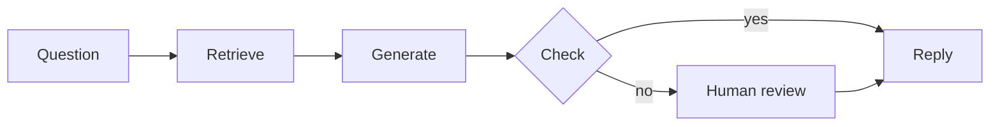
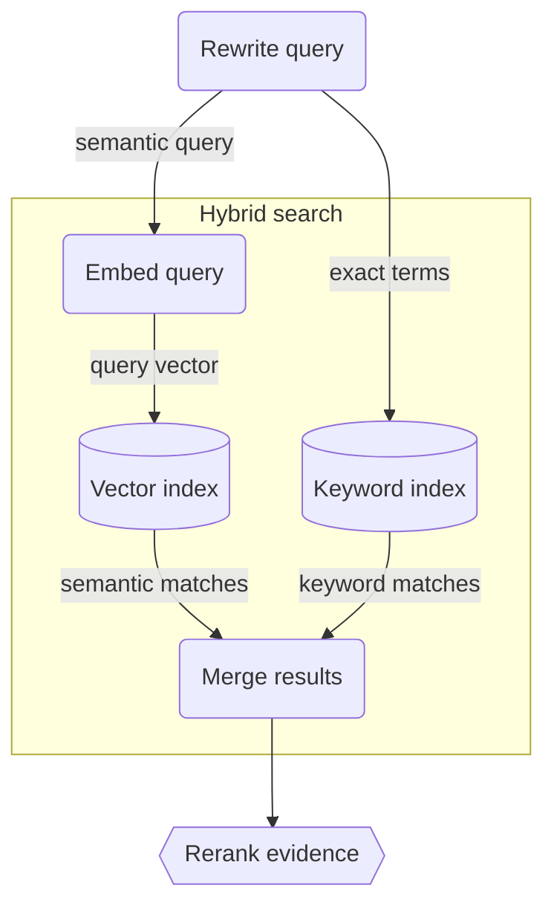
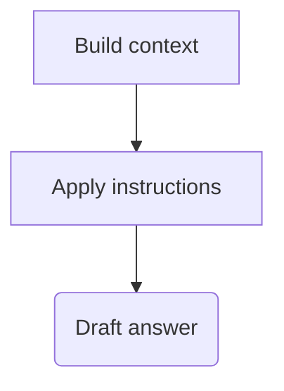
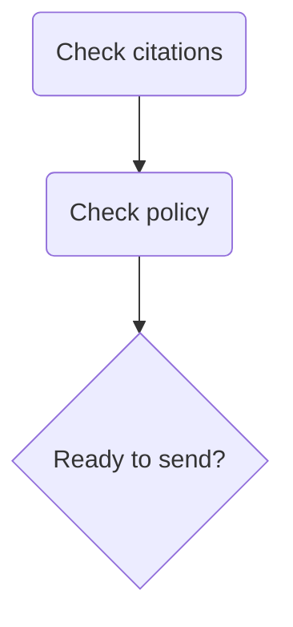

<!-- _class: lead -->

# One customer question

How do I export my workspace?

Harbor Notes · Architecture walkthrough

<!-- Harbor Notes is fictional. Start on the folded canvas before opening this deck. The same diagram supplies the live embeds on slides 3, 4, and 5. -->

---

## Follow the answer

The overview leads into the detailed groups on the canvas.

<!-- This simplified overview is a static Mermaid fence. The following slides embed the actual groups. Play the canvas flow to explain both available routes. -->

---

## Retrieve attributable evidence

Design · Search · Runbook

<!-- Return to the canvas and unfold Retrieve knowledge, then Hybrid search. Point out semantic and keyword queries. Fold Search again to show that its two incoming connections merge into one crease. -->

---

## Generate from the sources

Each factual claim keeps a source ID. See Response contract.

<!-- Show exports-01 and exports-02 on Support agent overview. Open Answer generation from the node, then open its second page, Response contract. -->

---

## Decide whether to send

Missing evidence leads to Human handoff.

<!-- The export question has supporting sources. The restoration question does not. Playback illustrates both paths; it does not execute these checks. -->

---

## Update the system once

1. Rename Rerank evidence to Rerank passages on the canvas.
2. Open Retrieval design and this deck in separate windows.
3. Watch the live diagrams update in both.
4. Export the full JSON file and reimport it to restore the workspace.

Open the guide

<!-- Return to slide 3 after the rename. The diagram updates while the authored prose stays as written. Export Mermaid for diagram structure and JSON for page content, decks, styling, layout, and folding. -->
